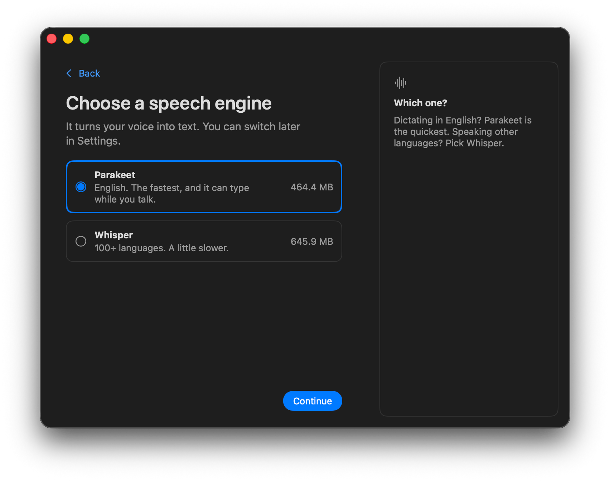
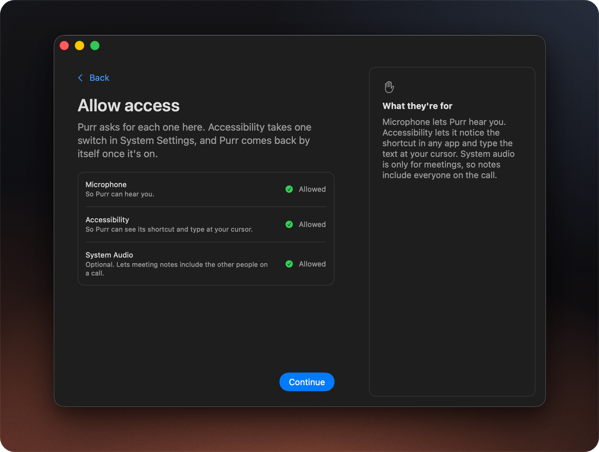
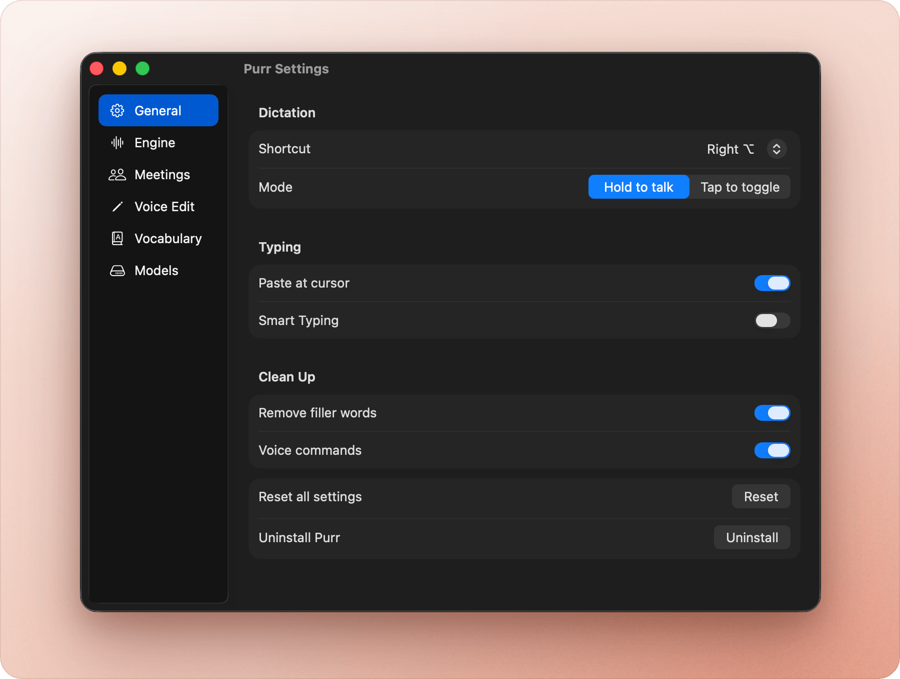
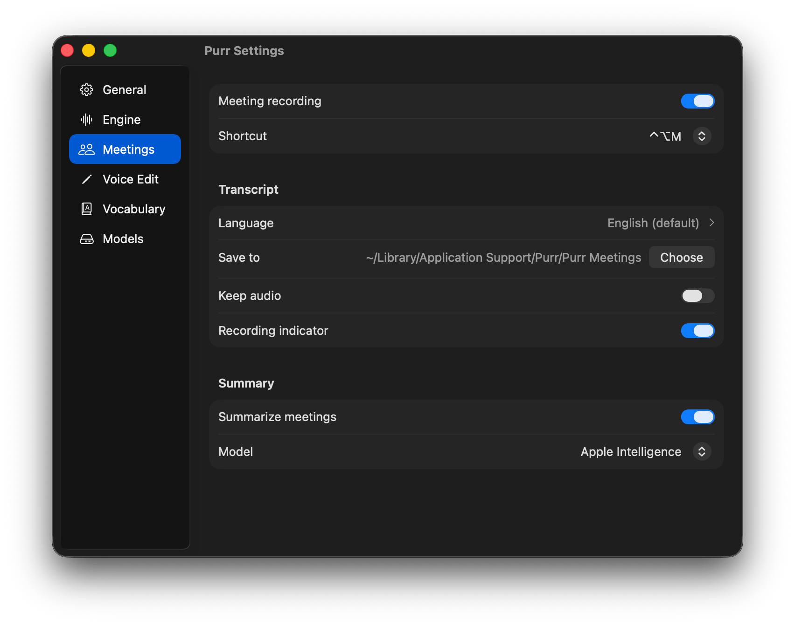
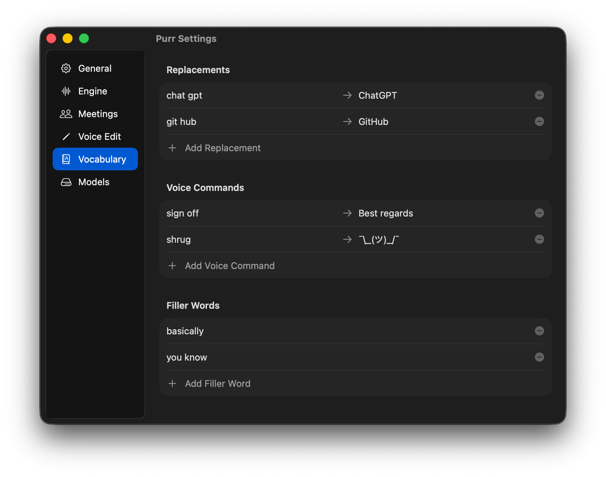
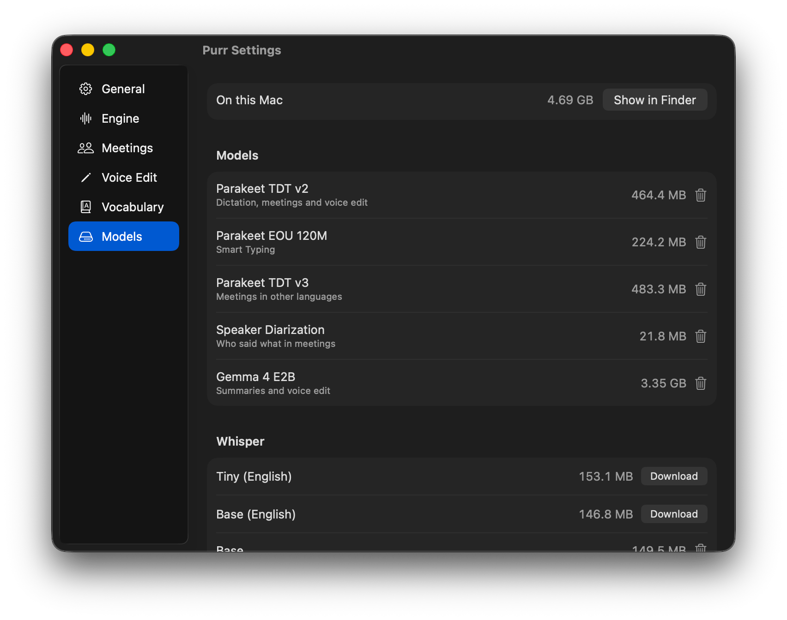

<div align="center">


# Purr

**Hold a key, speak, and your words appear in any app.**<br>
Dictation, meeting notes and voice editing that run entirely on your Mac.

[](LICENSE)
[](#requirements)
[](#requirements)

</div>

## Video Demo

https://github.com/user-attachments/assets/78a4fbca-b187-4965-b801-5f5d4ee1b128

## Features

- **Dictate** into any text field. Hold a key, talk, let go.
- **Smart Typing** types as you speak instead of waiting for you to let go.
- **Meetings** records your mic and the call, labels who said what, and saves Markdown notes with an optional summary.
- **Voice Edit** rewrites selected text when you say what to change.
- **Languages**: English by default, about 100 for dictation with Whisper, and 28 for meetings.
- **Voice commands** for punctuation, new lines and "scratch that", plus your own.
- **Vocabulary** listens for the names and terms you add, fixes words it keeps mishearing, and drops "um" and "uh".
- **Private**: no account, no cloud, no telemetry.

## Screenshots

<p align="center">
  
  
  
  
  
  
</p>

## Benchmarks

Purr, Wispr Flow (free plan, runs in the cloud) and Superwhisper (free plan, runs on the Mac) heard the same recordings in their dictation mode, played into each app as its microphone. Lower is better for time and errors.

| | Purr | Wispr Flow | Superwhisper |
|---|---|---|---|
| Time from key release to text | **0.22 s** | 0.63 s | 1.30 s |
| Word error rate (WER), everyday speech | 3.8% | **3.4%** | 9.0% |
| WER, hard audio (noise, accents, quiet speech) | **4.0%** | **4.0%** | 10.0% |
| WER, in non-English languages | 7.1% | **5.8%** | 12.1% |
| Names and terms spelled right (same list in each app) | 72.6% | **93.5%** | 51.6% |
| Works offline | **yes** | no | **yes** |

Purr's other modes were tested on their own:

- **Smart Typing** (types while you talk) had an 8.0% WER on the same everyday recordings, against 3.8% with Dictate.
- **Voice Edit** got 8 of 8 spoken edits right, such as "Change Tuesday to Thursday" and "Translate this to Spanish".
- **Meetings**: on 16 recorded meetings from the public AMI set, Purr labeled who said what with a 9.6% error rate and found the right number of speakers in 15. Its notes for a 55-minute meeting kept 36 of the 38 action items.

Wispr Flow is still ahead on rare names, other languages and, by a little, everyday speech. [Benchmarks](benchmarks/) has every result, Purr's scores on public test sets, and the scripts to run it yourself.

## Install

Download `Purr.dmg` from the [latest release](https://github.com/iamarunbrahma/purr/releases/latest), open it and drag Purr into Applications.

Or build it from source (needs Xcode):

```bash
git clone https://github.com/iamarunbrahma/purr.git
cd purr
make app
mv dist/Purr.app /Applications/
open /Applications/Purr.app
```

On first launch, a short setup picks the speech engine, downloads its model (about 450 MB for Parakeet) and asks for Microphone and Accessibility access. Then click into any text field, hold **Right Option**, speak and let go.

## Hot Keys

| Mode       | Default      | Behavior                                           |
| ---------- | ------------ | -------------------------------------------------- |
| Dictate    | hold right ⌥ | Hold to talk, release to type.                     |
| Meeting    | ⌃⌥ M         | Tap to start and stop. Records mic + system audio. |
| Voice Edit | ⌃⌥ E         | Select text, hold, say the change, release.        |

Meeting and Voice Edit are off until you turn them on in Settings. Each mode has a few other keys to pick from, and Dictate can also start and stop with a tap.

While dictating, say "comma", "period", "question mark", "new line", "new paragraph" or "scratch that". Add your own commands in **Settings > Vocabulary**.

## Requirements

- An Apple Silicon Mac with macOS 14 or later.
- macOS 14.2 or later to record the other people on a call.
- For summaries and Voice Edit, Apple Intelligence on macOS 26, or Gemma 4 E2B (a 3.35 GB download) on any version.

## FAQ

<details>
<summary><strong>Does anything leave my Mac?</strong></summary>

No. Recording, transcription, summaries and Voice Edit all run on your Mac. Purr only goes online to download models and to check GitHub for updates. Once the models are downloaded, it works offline.

</details>

<details>
<summary><strong>Which languages does it support?</strong></summary>

Dictation uses Parakeet for English. Switch to Whisper in **Settings > Engine** for about 100 other languages, pick the one you speak (auto-detect can misread short clips), and optionally translate it into English. Meetings work in English and 27 more languages (pick one in **Settings > Meetings**), and the summary is written in the meeting's language.

</details>

<details>
<summary><strong>Does meeting mode record the other people on my call?</strong></summary>

Yes. It records your mic and your Mac's audio output together, so remote voices are transcribed too. On macOS 14.0 and 14.1, only your mic is recorded.

When nothing plays through your Mac, like a meeting around one table, Purr tells the voices your mic hears apart and labels them Speaker 1, Speaker 2 and so on.

</details>

<details>
<summary><strong>I can't see the icon in the menu bar.</strong></summary>

On MacBooks with a notch, menu bar icons can hide behind it when the bar is full. Quit a few menu bar apps, hold ⌘ and drag icons to make room, or use [Ice](https://github.com/jordanbaird/Ice).

</details>

<details>
<summary><strong>How do I update Purr?</strong></summary>

The first time Purr starts after setup, it asks whether to check for updates automatically. If you say yes, it checks GitHub once a day. You can also click **Check for Updates** in the menu bar or in About at any time, and turn automatic checks on or off in **Settings > General**.

When there's a new version, you see what changed before anything installs. If one turns up while you're working, the menu bar icon gets a dot and the menu shows **Update Available**. Purr checks that each update is signed by its developer before it replaces the app, and it holds the relaunch while it's recording or transcribing.

</details>

<details>
<summary><strong>How do I remove the models or uninstall Purr?</strong></summary>

**Settings > Models > Delete All** removes every downloaded model and keeps your meetings and settings. Models download again when a feature needs them.

**Settings > General > Uninstall** moves Purr, its models and your meetings to the Trash, removes its settings, caches and permissions, and quits.

If you already dragged Purr to the Trash, put it back and use Uninstall, or remove the rest yourself:

```bash
rm -rf ~/Library/Application\ Support/Purr     # models and meetings
rm -rf ~/Library/Caches/com.arunbrahma.purr   # caches
defaults delete com.arunbrahma.purr           # settings
```

</details>

## License

Purr is MIT licensed. Copyright (c) 2026 Arun Brahma. See [LICENSE](LICENSE).

Models download on first use, are never bundled, and keep their own licenses:

- **Parakeet TDT v2** (NVIDIA, via FluidAudio): CC-BY-4.0
- **Parakeet Ultra** (moondream's post-training of NVIDIA's Parakeet TDT v3, via FluidAudio): CC-BY-4.0
- **Whisper** (OpenAI, via WhisperKit): MIT
- **Gemma 4 E2B** (Google): [Apache-2.0](https://www.apache.org/licenses/LICENSE-2.0)

Bundled code:

- **WhisperKit** (Argmax): MIT
- **FluidAudio** (FluidInference): Apache-2.0
- **llama.cpp** (ggml-org): MIT
- **SpeexDSP** (Xiph.Org): BSD-3-Clause, for echo cancellation in meetings
